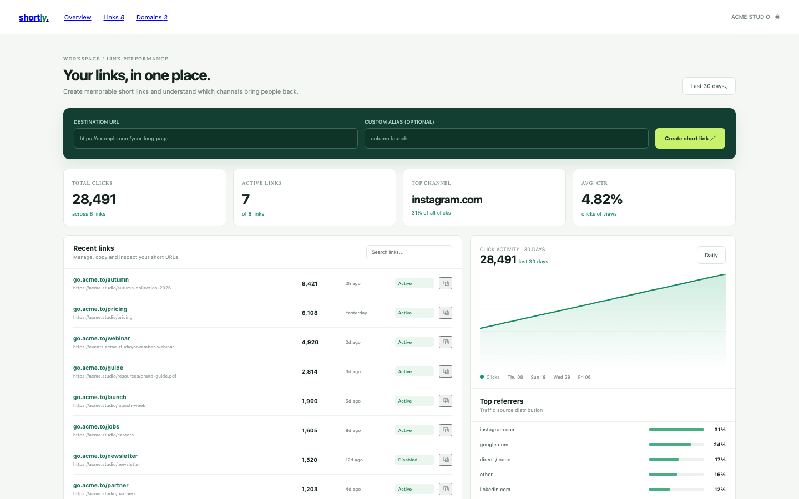

# Link Shortener

A light link-management workspace: create branded short links with a real redirect, watch clicks and referrers, and enable or disable a link.

## Run it

```sh
npm install
npm start
```

Open the address it prints. `npm test` runs the tests (node:test; no network, no key).

## What to ask the chat next

- Create a short link for a new campaign page and copy it.
- Disable a link and check that its redirect stops working.
- Open a link's detail page and compare its click activity with the referrer totals.

## Screenshot


